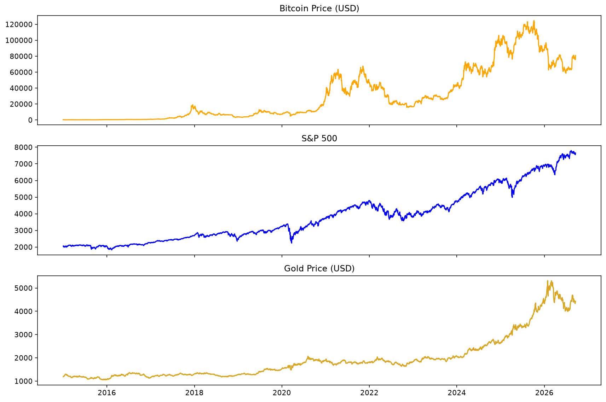
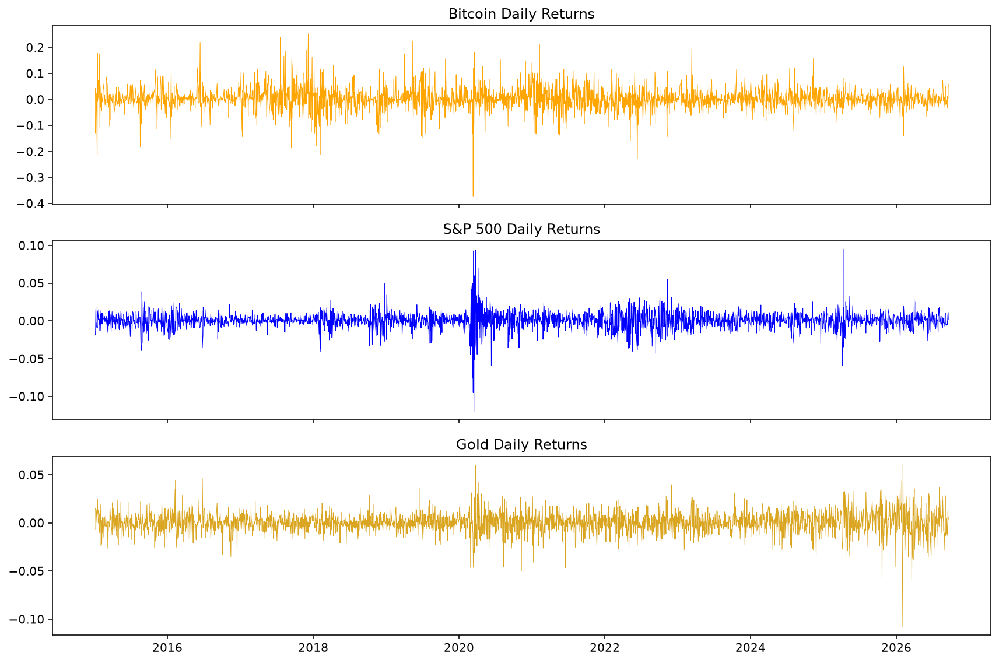
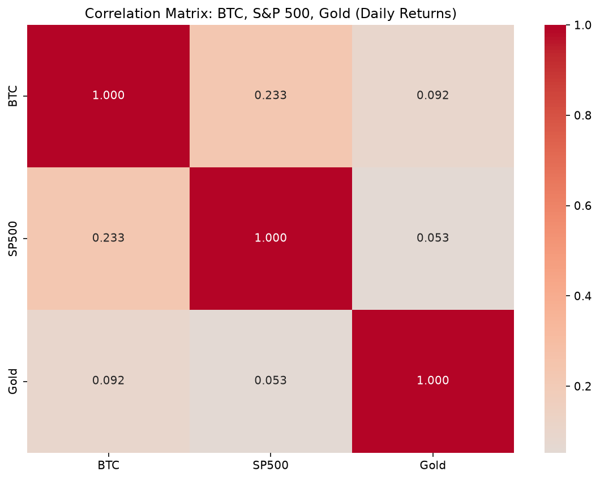
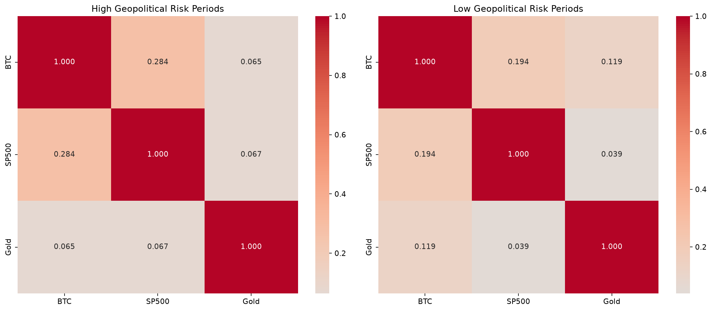

# Is Bitcoin "Digital Gold" or a Risk Asset?

An exploratory analysis of how Bitcoin's daily returns relate to the S&P 500 and gold, and whether those relationships change with **geopolitical risk** and **US unemployment**.

**Tools:** Python, pandas, statsmodels, matplotlib, seaborn, yfinance
**Period:** January 2015 – September 2026 (2,941 daily return observations)

---

## Research Question

Bitcoin is often described as "digital gold", a hedge that holds up when traditional markets are under stress. Does the data support that?

1. How correlated are Bitcoin's daily returns with equities (S&P 500) and gold?
2. Do those correlations change in periods of **high vs. low geopolitical risk**?
3. Do they change in periods of **high vs. low unemployment**?
4. Do equity returns, gold returns, unemployment and geopolitical risk jointly explain Bitcoin returns (OLS regression)?

---

## Data

| Source | Series | Frequency | Access |
|---|---|---|---|
| Yahoo Finance (`yfinance`) | Bitcoin (`BTC-USD`) | Daily | Downloaded in script |
| Yahoo Finance (`yfinance`) | S&P 500 (`^GSPC`) | Daily (trading days) | Downloaded in script |
| Yahoo Finance (`yfinance`) | Gold futures (`GC=F`) | Daily (trading days) | Downloaded in script |
| [FRED](https://fred.stlouisfed.org/series/UNRATE) | US unemployment rate (`UNRATE`) | Monthly | Download manually as `UNRATE.csv` |
| [Caldara & Iacoviello](https://www.matteoiacoviello.com/gpr.htm) | Geopolitical Risk Index (GPR) | Monthly | Download manually as `data_gpr_export.xls` |

---

## Method

1. **Download** daily closing prices for BTC, S&P 500 and gold.
2. **Align** the series on common trading days (Bitcoin trades 7 days a week, so weekend observations are dropped), leaving 2,942 price rows.
3. **Compute** daily percentage returns.
4. **Merge** the monthly unemployment and GPR series onto the daily index using forward-fill.
5. **Split** the sample at the median of GPR (and of unemployment) into "high" and "low" regimes and compare correlation matrices.
6. **Regress** Bitcoin returns on S&P 500 returns, gold returns, unemployment and GPR (OLS), and check multicollinearity with Variance Inflation Factors.

---

## Results

### Price history



### Daily returns



Bitcoin is far more volatile than either benchmark:

| | BTC | S&P 500 | Gold |
|---|---|---|---|
| Mean daily return | 0.275% | 0.051% | 0.050% |
| Std. deviation | 4.14% | 1.11% | 1.06% |
| Worst day | -37.2% | -12.0% | -10.8% |
| Best day | +25.2% | +9.5% | +6.1% |

### Full-sample correlation of daily returns



| | BTC | S&P 500 | Gold |
|---|---|---|---|
| **BTC** | 1.000 | 0.233 | 0.092 |
| **S&P 500** | 0.233 | 1.000 | 0.053 |
| **Gold** | 0.092 | 0.053 | 1.000 |

### Correlation by geopolitical-risk regime



| Pair | High GPR | Low GPR |
|---|---|---|
| BTC – S&P 500 | 0.284 | 0.194 |
| BTC – Gold | 0.065 | 0.119 |
| S&P 500 – Gold | 0.067 | 0.039 |

### Correlation by unemployment regime

Split at the median unemployment rate (4.2%):

| Pair | High unemployment | Low unemployment |
|---|---|---|
| BTC – S&P 500 | 0.231 | 0.230 |
| BTC – Gold | 0.076 | 0.109 |
| S&P 500 – Gold | 0.051 | 0.055 |

The BTC–S&P 500 correlation is essentially identical across unemployment regimes, in contrast to the shift seen across geopolitical-risk regimes.

### Regression: drivers of Bitcoin returns

OLS of daily BTC returns on S&P 500 returns, gold returns, unemployment rate and GPR (n = 2,918):

| Variable | Coefficient | Std. error | p-value | Significant (5%)? |
|---|---|---|---|---|
| S&P 500 return | 0.840 | 0.067 | <0.001 | Yes |
| Gold return | 0.313 | 0.071 | <0.001 | Yes |
| Unemployment | 0.0005 | 0.0005 | 0.269 | No |
| GPR | -0.000006 | 0.000018 | 0.740 | No |

**R² = 0.060** (F-test p < 0.001). A 1% rise in the S&P 500 is associated with roughly a 0.84% rise in Bitcoin on the same day, holding the other variables constant. The model explains only about 6% of the variation in Bitcoin's daily returns, so most of its movement is driven by factors outside these variables.

**Multicollinearity check (VIF):** S&P 500 1.01, Gold 1.01, Unemployment 3.60, GPR 3.60. All are below the common threshold of 5. Unemployment and GPR are moderately correlated (-0.32), which accounts for their higher VIFs. The large condition number reported by statsmodels (1.19e4) mostly reflects the very different scales of the variables (returns vs index levels), not severe collinearity.

---

## Key Findings

- **Bitcoin behaves more like a risk asset than a safe haven.** Its correlation with the S&P 500 (0.23) is more than double its correlation with gold (0.09).
- **The relationship with equities strengthens under geopolitical stress** (0.28 in high-GPR periods vs 0.19 in low-GPR periods), the opposite of what a "digital gold" hedge would show.
- **The link to gold weakens when geopolitical risk is high** (0.07 vs 0.12), though both values are very small.
- **All correlations are low in absolute terms.** Bitcoin's daily moves are mostly driven by factors outside these three markets.
- **Economic stress does not change the picture the same way.** The BTC–S&P 500 correlation is the same in high- and low-unemployment periods (0.23 vs 0.23), so the shift appears specific to geopolitical risk.
- **In the regression, only market returns matter.** S&P 500 (β = 0.84) and gold (β = 0.31) returns are significant; unemployment and GPR have no significant independent effect once market movements are controlled for.
- **Explanatory power is low (R² = 0.06).** Most of Bitcoin's daily variation comes from factors not captured here.

---

## Limitations

- Regime split is a simple above/below-median cut; no significance tests were run on the difference between regime correlations, so the differences above are descriptive.
- GPR and unemployment are monthly series forward-filled to daily frequency. This also assumes each monthly value was known from the 1st of the month, which is not true for unemployment (published with a lag).
- Regression mixes daily **returns** with **levels** of unemployment and GPR, which are on different scales and may be non-stationary.
- Gold is represented by front-month futures (`GC=F`), which can include contract-roll effects.
- The regression uses standard (non-robust) errors, but the residuals are fat-tailed (kurtosis ≈ 8.7), so heteroskedasticity-robust errors would be more appropriate.
- 23 trading days were dropped when merging macro data because of missing unemployment values (likely the unpublished October 2025 release), reducing the regression sample from 2,941 to 2,918.
- Correlation is not causation; results describe 2015–2026 only and may not hold in other periods.

## Possible Extensions

- Rolling (e.g. 90-day) correlations to show how the relationship evolves through time
- Significance tests for correlation differences between regimes (e.g. Fisher z-test)
- Use changes in unemployment/GPR rather than levels; use robust (HAC) standard errors
- Add other macro variables (VIX, interest rates, USD index)

---

## How to Run

```bash
git clone https://github.com/LewisBennett05/Personal-Project.git
cd Personal-Project
pip install yfinance pandas matplotlib seaborn statsmodels xlrd openpyxl
```

Place `UNRATE.csv` and `data_gpr_export.xls` in the project folder, then run:

```bash
python PersonalProject.py
```

## Repository Structure

```
├── PersonalProject.py
├── UNRATE.csv
├── data_gpr_export.xls
├── images/
│   ├── prices.png
│   ├── returns.png
│   ├── correlation_matrix.png
│   └── gpr_regimes.png
└── README.md
```

## Author

Lewis Bennett · [LinkedIn](https://www.linkedin.com/in/lewis-bennett-914290216/)
